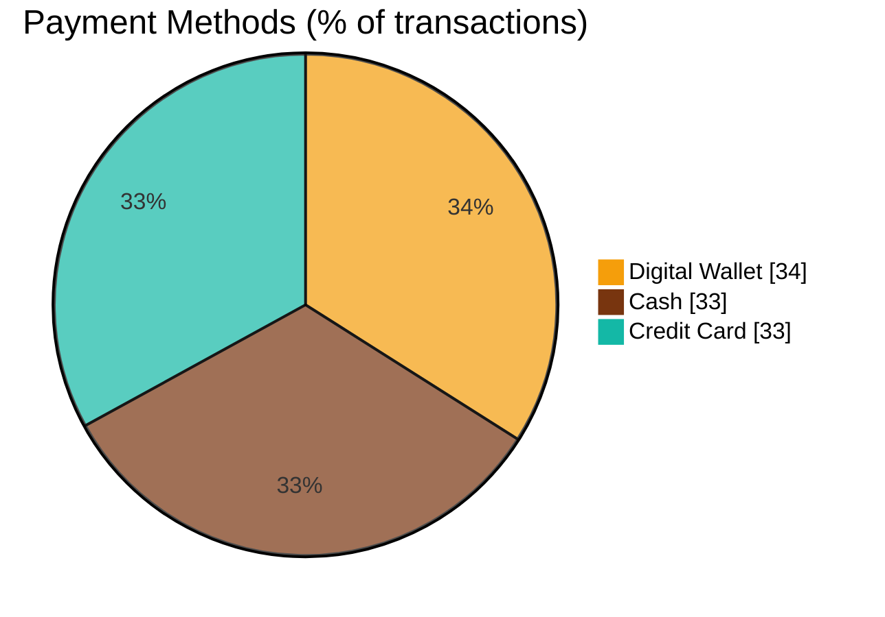

### Interactive Sales and Business Insights Dashboard

**Cafe sales, customer payment behaviour and product trends, in one Power BI dashboard.**

[📊 Dashboard Preview](#-dashboard-preview) · [💡 Key Insights](#-key-insights) · [📁 Project Files](#-project-files) · [📄 Full Report](./Cafe_Sales_Project_Report.pdf)

 

---

## 📌 Overview

This project takes raw cafe sales data and turns it into an interactive dashboard. The data was cleaned and transformed in **Excel**, then modelled in **Power BI**, where **DAX** measures and calculated columns power the visuals.

The dashboard looks at sales performance, how customers pay, which products sell best, and what the numbers suggest for the business.

---

## 🔢 Headline Numbers

| 💰 Total Revenue | 📈 Total Profit | 🧾 Transactions |
|:---:|:---:|:---:|
| **$85.25K** | **$80.98K** | **10K** |

| 📦 Units Sold | 🏷️ Avg Selling Price | 🚀 Growth vs Previous Month |
|:---:|:---:|:---:|
| **29K** | **$2.95** | **+9.26%** |

Net revenue margin is about **95%**.

---

## 🛠️ Tools Used

| Tool | What it was used for |
|------|----------------------|
| 🟢 **Microsoft Excel** | Data cleaning and transformation |
| 🟡 **Power BI** | Data modelling, DAX and dashboard design |
| 🔵 **DAX** | Measures and calculated columns |

---

## 🗺️ Project Flow

```mermaid
flowchart LR
    A["📄 Raw Data<br/>Cafe_Sales_Raw_Data.csv"] --> B["🟢 Excel<br/>cleaning and transformation"]
    B --> C["📑 Cleaned Data<br/>Cafe_Sales_Cleaned_Data.xlsx"]
    C --> D["🟡 Power BI<br/>data model"]
    D --> E["🔵 DAX<br/>measures and columns"]
    E --> F["📊 Dashboard<br/>5 pages + drill-through"]

    style A fill:#FEE2E2,stroke:#DC2626,color:#450A0A
    style B fill:#DCFCE7,stroke:#16A34A,color:#052E16
    style C fill:#FEF9C3,stroke:#CA8A04,color:#422006
    style D fill:#FEF3C7,stroke:#D97706,color:#451A03
    style E fill:#DBEAFE,stroke:#2563EB,color:#172554
    style F fill:#EDE9FE,stroke:#7C3AED,color:#2E1065
```

---

## ⚙️ Project Work

| Step | What was done |
|------|---------------|
| 1️⃣ | Cleaned and transformed the raw sales data in Excel |
| 2️⃣ | Built a data model in Power BI |
| 3️⃣ | Created DAX measures and calculated columns |
| 4️⃣ | Designed 5 dashboard pages with interactive slicers and page navigation, plus 1 hidden drill-through page |
| 5️⃣ | Added a **Reset** bookmark to clear all filters in one click |
| 6️⃣ | Added a hidden drill-through page (**Item Details**) for detailed views |

---

## 🧭 Dashboard Pages

| # | Page | What it shows |
|:-:|------|---------------|
| 1 | 🏠 **Home** | Starting page with navigation to the rest of the dashboard |
| 2 | 📈 **Executive Overview** | Overall sales performance |
| 3 | 👥 **Customer Analysis** | Customer behaviour and payment trends |
| 4 | 📦 **Product Analysis** | Item and category performance |
| 5 | 💡 **Business Insight** | Key findings and recommendations |
| 6 | 🔍 **Item Details** | Hidden drill-through page for detailed item views |

---

## 📊 Dashboard Preview

### 🏠 Home

### 📈 Executive Overview

### 👥 Customer Analysis

### 📦 Product Analysis

### 💡 Business Insight

### 🔍 Item Details (Drill-through)

---

## 💡 Key Insights

### 💰 Sales and Profit

| Insight | Detail |
|---------|--------|
| **Revenue and profit** | Total revenue of $85.25K with total profit of $80.98K (net revenue margin about 95%) |
| **Growth** | Sales grew 9.26% over the previous month |
| **Volume** | 10K transactions and 29K units sold, at an average selling price of $2.95 |
| **Target** | Revenue was slightly ahead of target: $7.22K against a $7.02K goal (+2.86%) |

### 👥 Customers and Payments

Payment methods are almost evenly split:

### 🛍️ Products and Orders

| Insight | Detail |
|---------|--------|
| 🥗 **Top item** | Salad was the top revenue-generating item |
| 🍽️ **Category** | Food brought in more revenue than Beverages |
| 🧺 **Order size** | Single-item orders were the largest share of transactions (43.1%), followed by bulk orders (38.66%) |
| 🏪 **Channel** | Revenue was split closely between in-store and takeaway sales |

### 📅 Trend

Monthly transaction volume stayed fairly steady through the year, with a rise toward Q4.

---

## 📁 Project Files

| File | Description |
|------|-------------|
| 📊 [Cafe Sales Performance and Analytics.pbix](./Cafe%20Sales%20Performance%20and%20Analytics.pbix) | Power BI project file |
| 🖼️ [Dashboard-Preview/](./Dashboard-Preview/) | Screenshots of every dashboard page |
| 📄 [Cafe_Sales_Raw_Data.csv](./Cafe_Sales_Raw_Data.csv) | Original, unprocessed sales data |
| 🟢 [Cafe_Sales_Cleaned_Data.xlsx](./Cafe_Sales_Cleaned_Data.xlsx) | Cleaned and transformed data used for the analysis |
| 📕 [Cafe_Sales_Project_Report.pdf](./Cafe_Sales_Project_Report.pdf) | Full project report with methodology and findings |
| ⚖️ [LICENSE](./LICENSE) | MIT license terms |

---

## 🚀 How to Open the Dashboard

1. Download the repository (green **Code** button, then **Download ZIP**) and unzip it.
2. Open `Cafe Sales Performance and Analytics.pbix` in **Power BI Desktop**.
3. Use the slicers to filter, the buttons to move between pages, and the **Reset** bookmark to clear your filters.
4. Right-click an item in the dashboard and choose **Drill through** to open the hidden **Item Details** page.

---

## 🎯 Skills Shown in This Project

| Area | What it covers |
|------|----------------|
| **Data cleaning** | Cleaning and transforming raw data in Excel |
| **Data modelling** | Building a data model in Power BI |
| **DAX** | Measures and calculated columns |
| **Dashboard design** | Slicers, page navigation, bookmarks and drill-through |
| **Business analysis** | Turning sales data into insights and recommendations |

---

## 👤 Project Author

**Ansania Salam**

---

## ⚖️ License

This project is licensed under the **MIT License**. See the [LICENSE](./LICENSE) file for details.

